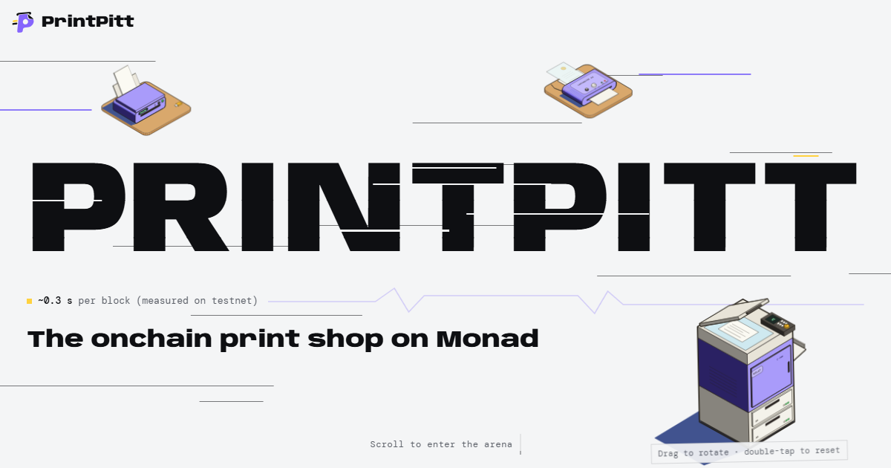

# PrintPitt — the onchain print shop on Monad

**Order a print from your phone, and two copy shops race for it onchain: the faster a shop finishes, the more it earns, and the rest flows back to you automatically.** Built for students and the copy kiosks around campus. Made at **Monad Blitz Jogja Vol. 2** (24 October 2026, Yogyakarta).



> Demo video: **[ADD LINK]**

## Try it now

| What | Where |
|---|---|
| Order from your phone (scan the QR on stage) | https://printpitt-app.vercel.app/pesan |
| Live board (projector) | https://printpitt-app.vercel.app/layar |
| Shop game (the two print shops) | https://printpitt-app.vercel.app/toko |
| Landing page | https://printpitt-landing.vercel.app (source: [`landing/`](landing/)) |
| Backend status (Railway) | https://backend-production-2b31.up.railway.app/status |

**Contracts on Monad Testnet (chain 10143)**, contract v2.2 (deploy block 73741333). Sourcify verification: **[pending for v2.2]**

| Contract | Address |
|---|---|
| `FotokopiKilat` (escrow, claim race, decaying payout, refund, NFT receipt) | [`0x08b700EEcbabcfFBe53c0dAbe4C2acF9aF4dc959`](https://testnet.monadvision.com/address/0x08b700EEcbabcfFBe53c0dAbe4C2acF9aF4dc959) |
| `TestIDRX` (tIDRX, test Rupiah token with `permit`) | [`0x6F11E9dd404AF78522DAb5104fF0b6153c7E4841`](https://testnet.monadvision.com/address/0x6F11E9dd404AF78522DAb5104fF0b6153c7E4841) |

Example transaction (contract deployment): [`0x3e35b5c4…6a6374f`](https://testnet.monadvision.com/tx/0x3e35b5c461622bca7e9b83e500196b045c8894ca3dc3935d1fc696b6b1a6374f). Example order transaction: **[ADD after demo]**.

**Run it locally (3 steps):**

```bash
git clone https://github.com/PrintPitt/frontend.git && cd frontend/web
npm install && cp .env.example .env.local   # testnet values: see "Moving to Monad testnet" in web/README.md
npm run dev                                  # open http://localhost:5173/pesan
```

It works if `/pesan` shows a Rupiah balance after "top up", and your order then appears on `/layar`.

## How it works (onchain flow)

1. **Order and pay.** The customer picks a job on `/pesan` (fixed-price jobs, or upload a real document priced per page by `hargaUntuk`) and pays in Rupiah (tIDRX). Uploaded files are stored encrypted by the backend; only the customer and the winning shop can download them, and they are deleted when the order is final. No gas needed: the customer signs an EIP-712 order plus an EIP-2612 `permit`, and our relayer submits it. The money sits in the contract's escrow, not with any shop.
2. **Race.** Shops within 1.5 km of the customer's rough location (3 km for Toko Pro) see the order and call `claim`. The first transaction in a block wins. The other shop gets "taken by Shop X".
3. **Work.** The winning shop completes each step (`completeStep`): copy → print → laminate. Its pay drops every second:
   `payout = price × (timeLimit − workTime) / timeLimit`, `refund = price − payout`.
4. **Ready and hand over.** The shop marks the order ready (payout is fixed at that moment). Funds are released when the shop scans the customer's secret QR at pickup.
5. **Too late?** `expire` refunds 100% automatically. A keeper calls it, no admin needed.
6. **Dispute.** While the order is ready, the customer can `komplain`. Funds are held until the operator decides; if nobody decides in time, `tutupSengketa` splits it 50/50.
7. **Receipt.** The customer gets an onchain SVG NFT receipt with the job, the order text, the shop and the work time.

Revenue model (live since contract v2.1): 3% platform fee on the shop's payout for completed orders, sent to the treasury (the customer's refund is never cut), Rp200 relayer fee per gasless order, and a "Toko Pro" subscription (Rp50,000 / 30 days, order radius 3 km instead of 1.5 km).

## Why Monad

- **~0.4 s blocks and ~0.8 s finality** (Monad docs). A claim race is decided in one block, so "who was first" is fair and instant.
- **Per-second pay only makes sense on a fast chain.** On a slow chain the order is stale before it confirms.
- **Low fees and full EVM.** Foundry, OpenZeppelin, viem and Envio work as-is, so a gasless Rupiah flow costs the customer nothing.

## Architecture

| Repo | What it does |
|---|---|
| `frontend` (this repo) | `web/`: React + Vite app with `/pesan` (phone), `/layar` (projector), `/toko` + 3D game. `landing/`: landing page. `assets/figures/`: interactive machine figures |
| `contracts` | `FotokopiKilat` + `TestIDRX` (Foundry, OpenZeppelin), unit + invariant tests, package `@printpitt/shared` (ABI, addresses, helpers) |
| `backend` | Railway service: faucet, simulated Rupiah top-up, relayer (gasless orders), keeper (auto `expire`), order bot |
| `indexer` | Envio HyperIndex: orders, shops, sessions, leaderboard, top-ups (GraphQL) |
| `vault` | Design docs, decisions, spikes, backlog, flow diagrams |

## Judging checklist

| Criterion | Where to check |
|---|---|
| Public GitHub repo | **[make repos public before submit]** |
| README with live URL + contract address | this file, "Try it now" |
| Contract on Monad Testnet, verified | table above (Sourcify verification pending for v2.2) |
| Publicly hosted | `printpitt-app.vercel.app`, `printpitt-landing.vercel.app`, Railway backend |
| Live onchain transaction in the demo | scan the QR → order → watch `/layar` and the explorer |
| Others can run it from the README | "Run it locally" above |
| Product-market fit, revenue, innovation | "How it works", revenue model, "Why Monad" |

## Built during the event vs prepared before

**[TEAM TO CONFIRM BEFORE SUBMIT]** Before 24 October: idea, research, spikes and design documents (`vault`). On 24 October: the repos in this org were created and the code was pushed (first commits 11:13 WIB). This includes contracts v2, v2.1 and v2.2, the relayer and backend, the indexer, the web app with the game, and the landing page.

## Limits and what breaks first

- Public RPC rate limits break first under load, so we use a keyed RPC plus a single relayer queue. More relayers are the next step.
- tIDRX is a test token. A real launch would use IDRX with a payment-gateway top-up.
- Mainnet deployment: **[ADD if done]**.

## Team

- **Hans Gunawan**: smart contracts, backend, indexer, architecture
- **Dave**: web app, `/pesan`, `/layar`, shop game
- **Dex Bennett**: product, landing page, pitch

---

## For developers

The frontend is deployed on Vercel. This repo also holds the machine figures and the integration contract.

### Assets

`assets/figures/{fotokopi,printer,laminator}`: interactive machine figures (standalone HTML, colorfigures). Open the `.html` file directly.

### Integration

| Need | Source |
|---|---|
| ABI, addresses, helpers (`teksValid`, `hitungPayout`, `formatRupiah`, `PESANAN_TYPES`, `PERMIT_TYPES`, `domainPesanan`, `domainTidrx`) | package `@printpitt/shared` from repo `PrintPitt/contracts` (folder `shared/`). While private: install the tarball `npm i ./vendor/printpitt-shared-0.1.0.tgz` (copy it from the backend repo's `vendor/`) |
| Backend API: `/faucet`, `/topup`, `/topup/:id`, `/bayar/:id`, `/relay/order`, `/config`, `/status` | repo `PrintPitt/backend`; spec in the vault, `04-Architecture/Desain Backend.md` |
| Snapshots, history, leaderboard (GraphQL) | repo `PrintPitt/indexer`; example queries in its README |
| Live game events | WebSocket straight to the Monad RPC (decision D-16) |

Frontend flows, rules and backlog: repo `PrintPitt/vault` → `06-FE-vault/`.

### App `web/` (frontend + game)

React + Vite + three.js (React Three Fiber). Pages: `/` landing, `/lobi` (lobby), `/main` (Overcooked-style 3D match), `/pesan` (customer phone), `/toko` (shop), `/layar` (projector board). Route names are Indonesian and stay as they are. Details in `web/README.md`.

```bash
cd web && npm install && npm run dev
```

Note: `shared/src/` in this repo is a copy of `@printpitt/shared` from repo `PrintPitt/contracts` (folder `shared/src/`, contract v2.2 `0x08b7…c959`). After a contract redeploy, copy `index.ts` and `fotokopiKilat.generated.ts` here again.
